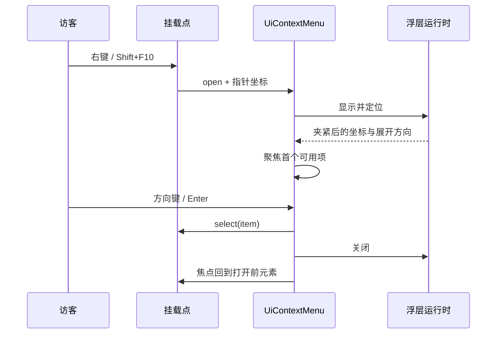

# 自定义右键菜单实施计划

Status: proposed

更新日期：2026-11-08。

本计划只覆盖“右键上下文菜单”这一交互：在门户若干区域替代浏览器默认菜单，使用与当前一致的极光玻璃浮层、键盘路径和双语文案。计划不含文本编辑器、富文本或文件管理功能。

## 结论

在 Neoverse-UI 新增共享组件 `UiContextMenu`，门户只维护挂载点、菜单项内容和命令映射。不在门户内另写一套定位、关闭与玻璃样式。

不在 `UiDropdownMenu` 外面包一层实现。共享浮层运行时按触发器元素定位（`trigger: HTMLElement`，读取 `getBoundingClientRect()`），没有指针坐标入口；`UiDropdownMenu` 也没有分组、分隔线、复选项和子菜单。包装层必须自己算坐标并自己装外部点击监听，等于在门户建立第二套浮层实现，与根工作规范的共享 UI 规则冲突。

首版范围：分组、分隔线、普通项、危险项、禁用项、单选组与复选组、快捷键标签、指针定位、键盘路径、焦点恢复、触屏长按。子菜单不进入首版，理由与替代方案见[风险与取舍](#风险与取舍)。

## 现状依据

| 事实 | 位置 |
| --- | --- |
| 浮层运行时只接受元素触发器，定位结果支持上翻、视口夹紧与 CSS 缩放补偿 | `Neoverse-UI/packages/overlay-runtime/src/index.ts` |
| `resolveAnchoredPosition` 本身接收矩形，可被指针定位复用 | 同上 |
| 原生 `popover="auto"` 提供顶层堆叠与轻触关闭，回退路径使用 `position: fixed` | `Neoverse-UI/docs/overlay-contract.md` |
| `UiDropdownMenu` 已提供 `role="menu"`、方向键循环、Home/End、跳过禁用项、选择后恢复焦点 | `Neoverse-UI/packages/vue/src/UiDropdownMenu.vue` |
| 浮层颜色、圆角、内边距、项前景与危险色全部来自 `--neoverse-overlay-*` 变量 | `Neoverse-UI/packages/tokens/src/components/overlay.css` |
| `UiPopover`、`UiDropdownMenu` 处于 `consumer-validation`，`UiPopover` 已有门户页头作为真实调用方 | `Neoverse-UI/contracts/component-matrix.json` |
| `canonical-shared` 要求 Vue 与 React 适配层均稳定、运行时覆盖已验证 | `Neoverse-UI/scripts/check-component-contracts.ts` |
| 新增公共组件须同步矩阵、文档行、Design Lab、浏览器用例与 Changeset | `Neoverse-UI/scripts/check.ts`、`Neoverse-UI/AGENTS.md` |
| 门户 `check:terminal` 禁止终端特性内出现裸 `<button>`，并禁止固定颜色与时长 | `scripts/check-terminal-boundary.ts` |
| 门户架构门禁禁止终端 core 与 commands 依赖共享 UI 与 Vue | `scripts/check-architecture.ts` |
| CI 在 `quality.yml`、`cinematic.yml`、`images.yml` 固定 Neoverse-UI 提交 | `.github/workflows/` |
| 门户已通过 `hasOpenTopLayerSurface()` 在顶层表面打开时跳过主题视图过渡 | `app/utils/top-layer.ts`、`app/composables/useSiteTheme.ts` |

## 组件划分

| 层 | 内容 | 归属 |
| --- | --- | --- |
| 定位 | 指针矩形到视口坐标，上翻、夹紧、缩放补偿、滚动与尺寸变化跟随 | `@neoverse-ui/overlay-runtime` 新增点定位入口，复用现有算法 |
| 结构与交互 | `role="menu"`、分组、分隔线、焦点移动、Escape、外部关闭、焦点恢复 | 新增 `UiContextMenu`（Vue 与 React） |
| 样式 | 玻璃面板、项状态、分隔线、危险项、减少动画与 forced-colors 回退 | `@neoverse-ui/tailwind` 新增 `context-menu.css`，只引用 `--neoverse-overlay-*` 与边框、动效变量 |
| 内容 | 每个挂载点的菜单项、文案、快捷键与执行动作 | 门户 `app/features/context-menu/` |

`UiContextMenu` 的公开参数（首版）：

| 参数 | 说明 |
| --- | --- |
| `items` | 条目数组，类型为 `item`、`separator` 或 `group`；条目含 `id`、`label`、`disabled`、`tone`、`shortcut`、`checked`、`group` |
| `open` / `defaultOpen` | 受控与非受控打开状态 |
| `anchor` | `{ x, y }` 指针坐标或元素矩形，二者取其一 |
| `ariaLabel` | 菜单的无障碍名称，必填 |
| `closeOnSelect` | 选择后是否关闭，默认关闭 |

事件为 `update:open` 与 `select`。选择项只上报条目，执行动作由调用方决定，组件不访问路由、剪贴板或会话。

## 交互与无障碍契约

- 打开：指针右键（`pointerdown` 的 `button === 2` 与 `contextmenu` 二选一，避免重复打开）；键盘 `Shift+F10` 与菜单键由浏览器同样派发 `contextmenu`，坐标缺省时取当前焦点元素的矩形中心。
- 阻止默认菜单只在注册了菜单的挂载点内生效。输入框、正文选区与未注册区域保留浏览器菜单，避免失去拼写检查、复制与辅助技术入口。
- 定位：默认从指针右下展开，下方空间不足时上翻，水平方向夹紧在视口内，边距取自 `--neoverse-space-4`。
- 关闭：Escape、面板外指针按下、选择条目、焦点离开面板、页面滚动或尺寸变化超出跟随范围。
- 焦点：打开后聚焦首个可用项；`ArrowUp` / `ArrowDown` 循环，`Home` / `End` 跳到首尾，禁用项跳过；关闭后焦点回到打开前的元素，元素已移除时回到文档主体。
- 触屏：长按 500 ms 打开，指针移动超过共享阈值或抬起时取消；不使用 `touchstart` 直接打开，避免与滚动冲突。
- 视觉：面板沿用 `--neoverse-overlay-*` 与玻璃材质；分组标题使用次要文字色，分隔线使用 `--neoverse-color-border-subtle`，危险项使用 `--neoverse-overlay-item-danger-foreground`；减少动态效果时直接显示，forced-colors 下保留系统色与焦点环。
- 顶层约束：面板使用 `popover="auto"`。同一时刻只允许一个自动浮层，因此子菜单必须渲染在同一面板内，而不是第二个自动浮层。



## 门户挂载点与菜单内容

| 区域 | 挂载位置 | 菜单项 | 复用能力 |
| --- | --- | --- | --- |
| 终端输出与命令历史 | `app/components/home/HeroSection.vue` 的 `.xca-terminal-anchor` 包装 | 复制选中、复制最后一条命令、清屏、清历史、切换背景、展开或还原、重放入场 | `session.execute()` 调用既有 `clear`、`history clear`、`xca background`、`xca intro`；展开由 `HeroSection` 的 `toggleExpanded` 提供 |
| 首页标题 | `app/components/home/HeroSection.vue` 标题容器 | 复制标题、复制副标题、重放入场、切换主题、切换语言 | `parseHeroTitle()` 结果、`useSiteTheme()`、`useSiteLocale()` |
| 页脚 | `app/components/site/SiteFooter.vue` | 复制链接地址、在新标签页打开、复制提交 SHA | 现有 `SITE.links` 与 `buildInfo` |
| 关于学社 | `app/components/about/AboutSection.vue` 卡片 | 复制选中、复制页面标题、复制页面地址 | `page.title`、`useRoute()` |
| 页头导航 | `app/components/site/SiteHeaderNavigation.vue` | 复制链接、在新标签页打开 | `SITE.navigation` |

终端菜单项通过 `session.execute()` 执行已注册命令，不直接改 `entries`、`history` 或外观状态，避免出现第二套状态入口。`CommandContext.clearHistory()` 目前只对命令开放，菜单不新增同名方法。

终端组件本身不感知右键菜单：挂载点位于 `TerminalHost` 外层，由首页组合；`app/features/terminal/` 不导入新特性，架构门禁的终端边界保持不变。

## 文件与分层

```text
app/features/context-menu/
  core/
    menu-model.ts          条目规范化、可用项顺序、键盘移动与快捷键文本
    menu-model.test.ts     纯逻辑单元测试
  presentation/
    useContextMenu.ts      指针与键盘入口、打开状态、焦点恢复、长按计时
    use-terminal-menu.ts   终端菜单项到已注册命令的映射
  components/
    ContextMenuHost.vue    共享 UiContextMenu 的门户适配与文案
  index.ts                 特性唯一对外入口
app/assets/css/context-menu.css  仅门户几何与挂载点层级，材质与颜色来自共享变量
```

文案新增到 `app/i18n/locales/zh-CN.json` 与 `en.json`，使用 `contextMenu.*` 前缀，两份键与插值参数保持一致。`docs/terminology/terms.md` 补“上下文菜单”条目。

## 实施顺序

1. 在共享库登记组件需求，记录门户挂载点与验收条件（见下节）。需求已登记为 `CR-20261108-9C1D88B5`，状态 `reported`，未获授权前不进入实现。
2. 共享库实现：浮层运行时点定位入口、`UiContextMenu` Vue 与 React 适配、单元与浏览器用例、Design Lab 样例、矩阵与文档行、Changeset。
3. 门户接入：特性模块、各挂载点、双语资源、终端菜单项映射。
4. 门户文档：`docs/architecture/site-shell.md` 与 `docs/architecture/terminal-extending.md` 各补一段接入说明；共享库 `docs/overlay-contract.md` 补点定位与关闭规则。
5. 验证：共享库 `bun run check`、门户 `bun run check`、`bun run test:e2e`，新增视觉基线只在确认渲染后更新。

## 验证矩阵

| 场景 | 覆盖方式 |
| --- | --- |
| 条目规范化、禁用跳过、循环与首尾移动、快捷键文本 | `menu-model.test.ts` 单元测试 |
| 指针定位、上翻、视口夹紧、缩放补偿 | 浮层运行时单元测试与浏览器用例 |
| 右键打开、外部关闭、Escape、焦点恢复 | Playwright 门户用例 |
| 键盘 `Shift+F10` 与菜单键 | Playwright 门户用例 |
| 触屏长按与移动取消 | Playwright 移动视口用例 |
| 浅色、深色、减少动画、forced-colors | 门户视觉基线 |
| 主题与语言切换不重建会话、不丢历史 | 既有 `preferences` 与 `terminal` 用例回归 |

## 风险与取舍

| 风险 | 影响 | 处理 |
| --- | --- | --- |
| 第二个 `popover="auto"` 会关闭父面板 | 子菜单若用独立浮层，父菜单立即消失 | 首版不做子菜单，单选组与复选组在同一面板内展开 |
| 门户 CI 固定共享库提交 | 共享组件合并后，门户仍装旧版本，接入无法开始 | 先推进固定提交，再开始门户接入；两阶段分开验证 |
| 右键菜单覆盖浏览器菜单 | 丢失拼写检查、辅助技术入口与系统菜单 | 只在注册挂载点阻止默认，其他区域保留 |
| 触屏长按与页面滚动冲突 | 误开菜单或无法滚动 | 移动阈值与抬起取消，长按时长取共享动效变量 |
| 顶层表面抑制主题过渡 | 菜单打开时切换主题不播放视图过渡 | 与现有 `hasOpenTopLayerSurface()` 行为一致，属预期 |
| 门户单文件与函数预算（300 / 60 行） | 菜单模型与入口易超出上限 | 纯逻辑、入口、组件与样式分文件，按职责拆分而非按行数 |
| 剪贴板写入失败 | 复制项无反馈 | 复制结果写入终端一行状态文本，失败显示 `error.*` 文案 |
| 不实现粘贴与检查元素 | 与系统菜单能力不对等 | 明确不在范围内，粘贴依赖剪贴板读权限，浏览器不保证 |

## 未采用方案

- 门户内自建浮层：与共享 UI 规则冲突，且需要重写定位、关闭与玻璃样式。
- 扩展 `UiDropdownMenu` 接受指针坐标：会让触发器语义与指针语义混在同一 API，触发器宽度匹配、焦点恢复与箭头键路径都需要分支。
- 原生 `<menu>` 元素或 `showContextMenu`：浏览器未提供可移植的原生上下文菜单 API。

## 后续

子菜单、图标与快捷键注册表在首版交付后按真实调用点评估。若需要子菜单，改为在单一自动浮层内嵌套渲染，并补左右方向键与 Escape 逐级返回；该变更进入新的组件需求，不直接扩大已交付范围。
